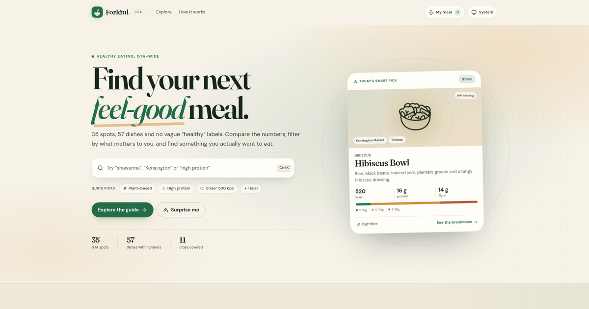

# Forkful

**Find your next feel-good meal.** Forkful is a GTA-wide guide to healthier dishes, with the numbers attached: calories, protein, carbs, fat, fibre, sugar, sodium, saturated fat and a transparent 100-point health score.

[Live site](https://jorgequijano.github.io/food-finder/) · [How the score works](https://jorgequijano.github.io/food-finder/#method)



## What it does

- **Search the whole guide** by dish, restaurant, cuisine or neighbourhood. Filters live in the URL, so a search can be shared.
- **Filter with intent** by city, cuisine, plant-based / vegetarian / halal / gluten-free / dairy-free options, max calories, minimum protein and an 80+ health score.
- **Browse places or dishes** — see the best matching dish at each spot, or line individual dishes up by health score, protein, calories, rating or distance.
- **Read the full breakdown** on every dish: calories, protein, carbs, fat, saturated fat, fibre, sugar and sodium, with a macro split and % daily values based on a 2,000 kcal reference diet.
- **Build a plate** with the meal builder. It tracks combined calories and macros, compares the total to a 1,600 / 2,000 / 2,500 kcal reference, and offers a couple of practical nudges.
- **Near me** uses your browser location (only when you ask) to sort by approximate straight-line distance to neighbourhood centres.
- **System theme first** — Forkful follows your device’s light/dark setting by default, with a manual System / Light / Dark switch that persists.

The interface is responsive down to 320px, uses native dialogs and a focus-trapped filter drawer, and has been checked against axe-core for WCAG 2.1 A/AA and best-practice rules in both themes.

## Run it locally

Forkful is static — no build step, no dependencies to install.

```bash
cd food-finder
python3 -m http.server 4173
# open http://localhost:4173
```

Use a local server rather than opening `index.html` directly, because the app uses native ES modules.

## How the health score works

Each dish gets a 0–100 score based on nutrient density per 100 kcal:

| Factor | Points |
| --- | ---: |
| Protein density | 22 |
| Fibre density | 22 |
| Lower sodium | 20 |
| Lower sugar | 16 |
| Lower saturated fat | 10 |
| Base score | 10 |

Fried dishes lose 8 points. Very sweet items get a small extra deduction, and servings over 700 kcal lose 3 points. Scores are rounded and capped at 0–100.

Bands: **80–100 Excellent**, **70–79 Strong**, **60–69 Balanced**, **under 60 Treat**. The score is a comparison tool, not a judgment or a medical recommendation. The full explanation is in the app under **How scores work**.

## Data & caveats

This is an independent demo project. Restaurant names are used for place-finding context; it is not affiliated with or endorsed by any restaurant.

Menu items, ratings, locations and nutrition figures are illustrative estimates for typical servings, not official restaurant data. Menus and recipes change, and the map links point to neighbourhood-level searches rather than exact doors. Confirm ingredients, allergens, hours and current menus with the restaurant. Nothing here is medical advice.

## Tech

- Vanilla JavaScript ES modules, semantic HTML and custom CSS
- Self-hosted variable fonts (no external font or JS CDN at runtime)
- `localStorage` for theme, meal and meal target
- `prefers-color-scheme` listener for live system-theme changes
- Browser geolocation only when “Near me” is clicked, never stored
- No frameworks, no backend, no tracking

```text
food-finder/
├── index.html
├── css/
│   └── styles.css
├── js/
│   ├── app.js       # UI, filtering, dialogs, meal builder, theme
│   ├── data.js      # GTA spots and sample menus
│   └── nutrition.js # scoring and nutrition helpers
├── assets/
│   ├── favicon.svg
│   ├── preview.png
│   └── fonts/       # DM Sans, Fraunces, Noto Emoji + OFL licences
├── .nojekyll
└── README.md
```

## Deploy

The site is deployed with GitHub Pages from the `main` branch root. `.nojekyll` keeps GitHub from running Jekyll on the static files.

```bash
gh repo create food-finder --public --source=. --remote=origin --push

cat >/tmp/forkful-pages.json <<'JSON'
{"source":{"branch":"main","path":"/"}}
JSON

gh api --method POST repos/JorgeQuijano/food-finder/pages \
  --input /tmp/forkful-pages.json
```

## Credits

- [DM Sans](https://fonts.google.com/specimen/DM+Sans) and [Fraunces](https://fonts.google.com/specimen/Fraunces), licensed under the SIL Open Font License.
- [Noto Emoji](https://fonts.google.com/noto/specimen/Noto+Emoji), used as a monochrome fallback for food emoji on systems without an emoji font, licensed under the SIL Open Font License.
- Built with care for the GTA.
